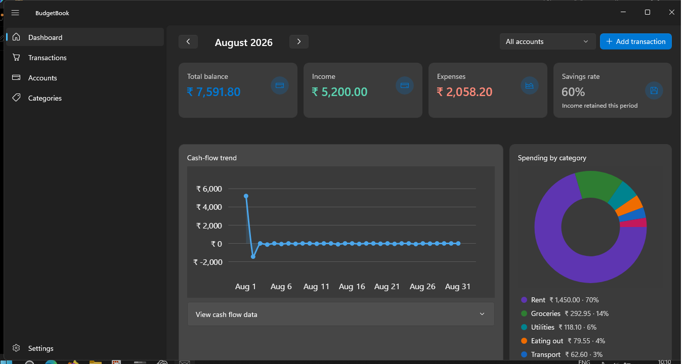
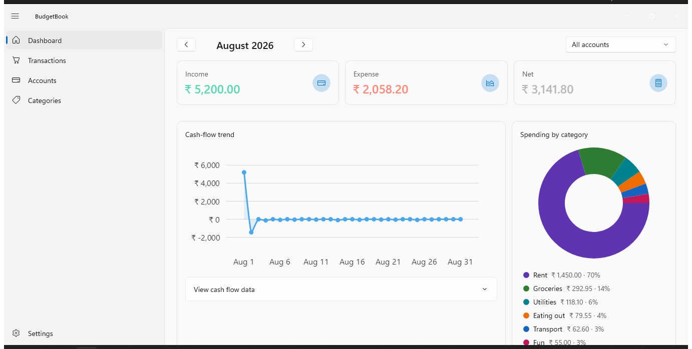
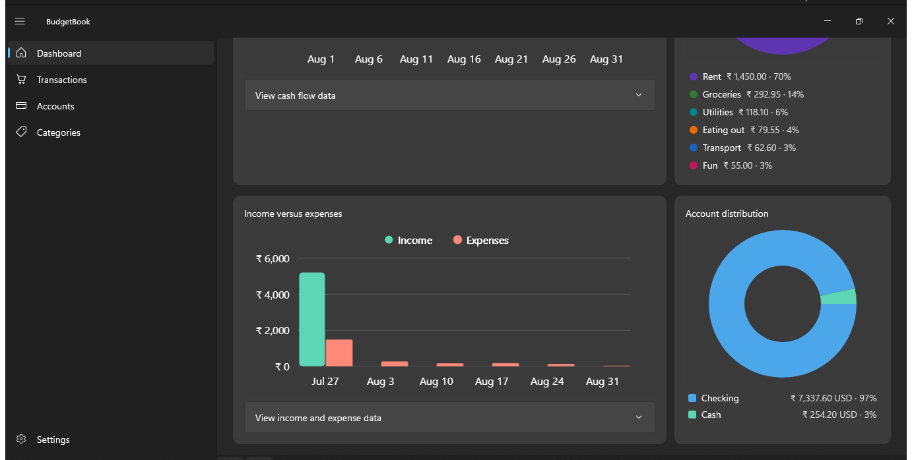
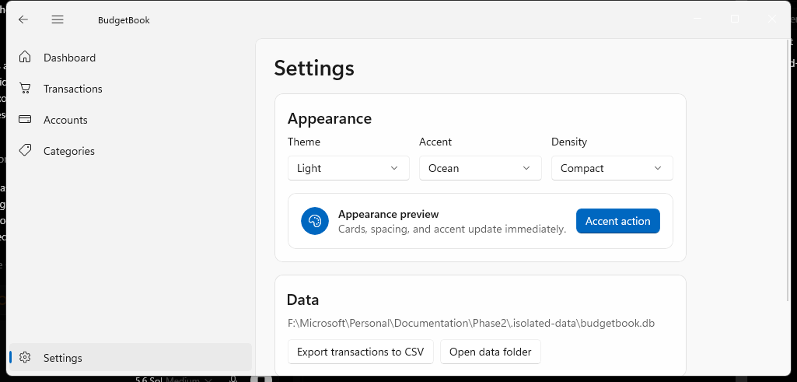
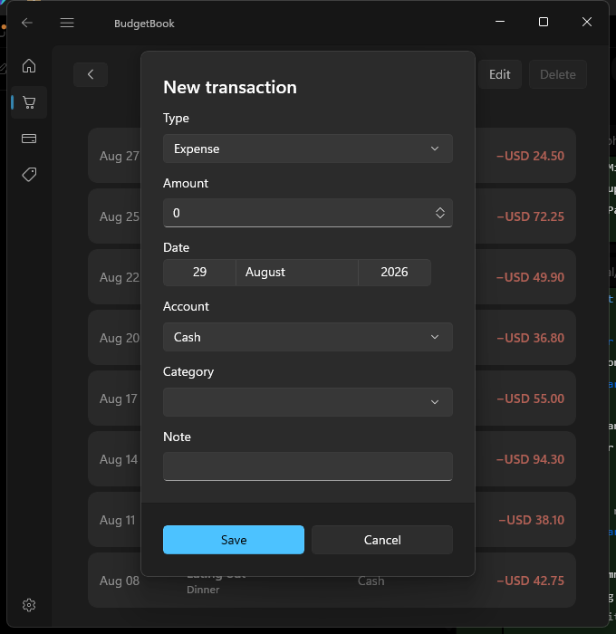

# BudgetBook

A local-first personal finance tracker for Windows, built with **C# / .NET 8 and WinUI 3 (Windows App SDK)**.
All data stays on the device in a SQLite database. There is no account, no cloud and no telemetry.



## Features

- **Dashboard**: month and account filters, total balance, income, expenses and savings-rate cards, a cash-flow trend chart, spending by category, recent activity, and quick add. Clicking a chart drills into the matching transactions.
- **Transactions**: monthly list with add, edit and delete (type, amount, date, account, category, note), including linked transfers between accounts.
- **Accounts**: live balance (opening balance plus signed transactions).
- **Categories**: colour-coded expense, income and transfer categories.
- **Budgets and reports**: budget-versus-actual, category breakdowns, cash flow, income versus expense, period comparison, account distribution and a monthly PDF report.
- **Settings**: Light, Dark or System theme, accent palettes, compact or comfortable density, CSV export, and a shortcut to the data folder.
- **Accessibility**: High Contrast resources, accessible names on icon-only buttons, and reduced motion that follows the Windows animation setting.
- Responsive layout from wide desktop down to narrow windows.

| Light theme | Dark theme, charts |
|---|---|
|  |  |
|  |  |

## Tech stack

| Area | Choice |
|---|---|
| UI | WinUI 3 (Windows App SDK 2.4), XAML, `NavigationView` shell |
| Pattern | MVVM with CommunityToolkit.Mvvm, one view model per page, dependency injection |
| Data | EF Core + SQLite, tracked schema migrations, short-lived `DbContext` per operation |
| Charts | LiveChartsCore |
| Tests | xUnit: 27 tests covering exact decimal maths, report boundaries, 10,000-row performance, migrations from a legacy database, theme resource parity, and XAML accessibility gates |
| Packaging | Self-contained, unpackaged EXE, or a sideload / Store MSIX for x64 and ARM64 |

## Project layout

| Path | Purpose |
|---|---|
| `Data/` | Models, `AppDbContext`, starter-data seed, EF Core migrations |
| `Services/` | Async data access behind interfaces (transactions, accounts, categories, budgets, reports, settings) |
| `Reports/` | Pure finance calculations and chart-ready report models |
| `ViewModels/` | Page view models |
| `Pages/`, `Controls/` | XAML pages and reusable cards, summaries, empty states, skeletons and chart controls |
| `Themes/`, `Settings/` | Semantic colour, spacing and typography tokens, and live theme switching |
| `BudgetBook.Tests/` | Automated test suite |
| `Documentation/` | Screenshots per phase and release-readiness notes |

## Build and run

**Requirements:** Windows 10 1809 or later (Windows 11 recommended) and the [.NET 8 SDK](https://dotnet.microsoft.com/download/dotnet/8.0). Visual Studio is optional.

```powershell
git clone https://github.com/Prathapdom/BudgetBook.git
cd BudgetBook

# Build (x64)
dotnet build BudgetBook.sln -c Debug -p:Platform=x64

# Run the tests
dotnet test .\BudgetBook.Tests\BudgetBook.Tests.csproj -p:Platform=x64

# Launch
.\bin\x64\Debug\net8.0-windows10.0.26100.0\win-x64\BudgetBook.exe
```

If that path differs on your machine, search the `bin` folder for `BudgetBook.exe`.

The app is self-contained (`WindowsAppSDKSelfContained=true`), so the Windows App Runtime does not need to be installed.

On first run the app creates and seeds `%LOCALAPPDATA%\BudgetBook\budgetbook.db`.
To try it without touching real data, set a throwaway data folder first:

```powershell
$env:BUDGETBOOK_DATA_DIR = "$env:TEMP\budgetbook-demo"
```

### Create a sideload MSIX

```powershell
dotnet build .\BudgetBook.csproj -c Release -p:Platform=x64 `
  -p:GenerateAppxPackageOnBuild=true -p:UapAppxPackageBuildMode=SideloadOnly -p:AppxBundle=Never
```

The `mspdbcmf.exe not found` warning only skips the optional symbols package.

## Background

A learning project to take a Windows desktop app from an empty folder to a Store-ready MSIX without Visual Studio. It was built in phases: foundation, design tokens, reusable controls, reports, charts, responsive dashboard, budgets, PDF reports, and release readiness. Each phase's notes and screenshots are in [`Documentation/`](Documentation/).

The feature set was inspired by the open-source [flow-mn/flow](https://github.com/flow-mn/flow) app. The code and UI here are original.
